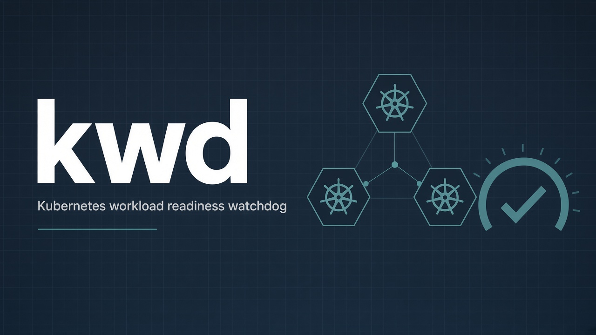

# kwd-selfhosted

[](https://github.com/hrodrig/kwd-selfhosted/releases)
[](https://github.com/hrodrig/kwd-selfhosted/releases)
[](https://opensource.org/licenses/MIT)
[](https://github.com/hrodrig/kwd/pkgs/container/kwd)
[](https://github.com/hrodrig/kwd)
[](https://github.com/hrodrig/kwd-selfhosted/actions/workflows/ci.yml)
[](https://gghstats.hermesrodriguez.com/hrodrig/kwd-selfhosted)



Deployment manifests and operator notes for **[kwd](https://github.com/hrodrig/kwd)** — `docker run`, in-cluster CronJob/Deployment, standalone cron/systemd. **App source and releases:** [github.com/hrodrig/kwd](https://github.com/hrodrig/kwd).

**Default app image pin:** [`ghcr.io/hrodrig/kwd:v0.2.0`](https://github.com/hrodrig/kwd/releases/tag/v0.2.0).

**Policies:** [Community and policies](#community-and-policies), [community standards](#community-standards) — changelog, contributing, security, code of conduct, agent guidelines.

---

## Table of contents

- [Pick a path](#pick-a-path)
- [What is in this repo (and what is not)](#what-is-in-this-repo-and-what-is-not)
- [Standalone binary](#standalone-binary)
- [Docker single container](#docker-single-container)
- [Kubernetes manifests](#kubernetes-manifests)
- [Example profiles](#example-profiles)
- [Secrets and notifications](#secrets-and-notifications)
- [Repository layout](#repository-layout)
- [Versioning](#versioning)
- [Checks](#checks)
- [Community and policies](#community-and-policies)
- [Community standards](#community-standards)
- [License](#license)

---

## Pick a path

| You want… | Section |
|-----------|---------|
| **Binary only** (no Docker) | [Standalone binary](#standalone-binary) — Linux: [cron / systemd](run/standalone/linux/README.md) |
| **Single container** (`docker run`) | [Docker single container](#docker-single-container) |
| **Kubernetes, scheduled single-pass** | [Kubernetes manifests](#kubernetes-manifests) — [cronjob.yaml](run/kubernetes/manifests/cronjob.yaml) |
| **Kubernetes, daemon** (`interval > 0` + `/healthz`) | [Kubernetes manifests](#kubernetes-manifests) — [deployment.yaml](run/kubernetes/manifests/deployment.yaml) |
| **Starter YAML** | [Example profiles](#example-profiles) |

Deeper index: **[`run/README.md`](run/README.md)**.

**[↑ Contents](#table-of-contents)**

---

## What is in this repo (and what is not)

| In **kwd-selfhosted** | In **[hrodrig/kwd](https://github.com/hrodrig/kwd)** |
|-----------------------|-----------------------------------------------------|
| Operator README, **`run/`** | CLI source, **`make release-check`**, unit tests |
| Docker / Kubernetes / standalone notes | **`ghcr.io/hrodrig/kwd`**, binaries, `.deb` / `.rpm` |
| Example profiles under **`run/examples/`** | Canonical sample: **`configs/kwd.sample.yml`** |
| Docs CI (`make release-check`) | govulncheck, grype, GoReleaser, Cosign, SBOM |

**Not shipped here (yet):** Docker Compose, Helm chart, kind e2e. Prefer flat manifests under **`run/kubernetes/manifests/`**.

**[↑ Contents](#table-of-contents)**

---

## Standalone binary

**Goal:** run **kwd** without Docker — release tarball, packages, or `go install`.

**All implementation detail** (cron lines, systemd unit sketch, BSD ports) is in **[`run/standalone/`](run/standalone/README.md)** — start with **[Linux](run/standalone/linux/README.md)**.

**Smoke test** (single-pass, no cluster mutations beyond read) — install from [kwd Install](https://github.com/hrodrig/kwd/blob/main/README.md#install), copy a profile, point at your kubeconfig:

```bash
# Example: go install or extract a release tarball onto PATH
export KUBECONFIG="$HOME/.kube/config"
cp run/examples/kwd-minimal.yml /tmp/kwd.yml
# Edit resources: in /tmp/kwd.yml for your cluster
kwd analyze --config /tmp/kwd.yml
kwd check --config /tmp/kwd.yml --dry-run
```

**macOS / BSD:** [run/standalone/macos](run/standalone/macos/README.md) · [run/standalone/bsd](run/standalone/bsd/README.md)

**[↑ Contents](#table-of-contents)**

---

## Docker single container

**Goal:** one container, no Compose file. Image is **distroless** (no shell).

**Image:** `ghcr.io/hrodrig/kwd:v0.2.0`

### One-shot (single-pass)

```bash
docker run --rm \
  -v "$HOME/.kube/config:/kube/config:ro" \
  -v "$(pwd)/run/examples/kwd-minimal.yml:/config/kwd.yml:ro" \
  -e KUBECONFIG=/kube/config \
  -e KWD_SLACK_WEBHOOK \
  ghcr.io/hrodrig/kwd:v0.2.0 \
  check --config /config/kwd.yml
```

Omit `KWD_SLACK_WEBHOOK` when sinks are disabled, or set `dry_run: true` in the profile.

**Check:** process exit `0` (ready) or `1` (not-ready / error) for `interval: 0`.

### Daemon (`interval > 0`)

```bash
docker run -d --name kwd \
  -v "$HOME/.kube/config:/kube/config:ro" \
  -v "$(pwd)/run/examples/kwd-daemon.yml:/config/kwd.yml:ro" \
  -e KUBECONFIG=/kube/config \
  -e KWD_SLACK_WEBHOOK \
  -p 127.0.0.1:8080:8080 \
  ghcr.io/hrodrig/kwd:v0.2.0 \
  check --config /config/kwd.yml
```

**Check:** `curl -sS -o /dev/null -w '%{http_code}\n' http://127.0.0.1:8080/healthz` (expect `200` after the first tick; `503` before).

**Remove:**

```bash
docker stop kwd && docker rm kwd
```

**More:** [run/docker/README.md](run/docker/README.md)

**[↑ Contents](#table-of-contents)**

---

## Kubernetes manifests

**Goal:** run **kwd** in-cluster with a **ServiceAccount** and **read-only** RBAC (no Helm chart in v0.1.x).

**Image pin in manifests:** `ghcr.io/hrodrig/kwd:v0.2.0`

```bash
kubectl apply -f run/kubernetes/manifests/namespace.yaml
kubectl apply -f run/kubernetes/manifests/rbac.yaml
kubectl apply -f run/kubernetes/manifests/configmap.yaml
# Optional Slack: create Secret from secret.example.yaml (do not commit real webhooks)
# kubectl apply -f run/kubernetes/manifests/secret.yaml
```

Then choose **one** shape:

| Shape | Manifest | ConfigMap key |
|-------|----------|---------------|
| Scheduled single-pass | [cronjob.yaml](run/kubernetes/manifests/cronjob.yaml) | `kwd.yml` (`interval: 0`) |
| Long-running daemon + Service `:8080` | [deployment.yaml](run/kubernetes/manifests/deployment.yaml) | `kwd-daemon.yml` (`interval > 0` + `http.listen`) |

Edit `resources:` in the ConfigMap for your workloads. Full walkthrough: **[run/kubernetes/README.md](run/kubernetes/README.md)**.

**[↑ Contents](#table-of-contents)**

---

## Example profiles

| File | Shape |
|------|--------|
| [run/examples/kwd-minimal.yml](run/examples/kwd-minimal.yml) | Single-pass (`interval: 0`) |
| [run/examples/kwd-daemon.yml](run/examples/kwd-daemon.yml) | Daemon + HTTP `/healthz` + `/metrics` |

Schema: upstream [SPECIFICATIONS.md](https://github.com/hrodrig/kwd/blob/main/SPECIFICATIONS.md) and [configs/kwd.sample.yml](https://github.com/hrodrig/kwd/blob/main/configs/kwd.sample.yml).

**[↑ Contents](#table-of-contents)**

---

## Secrets and notifications

Slack (v0 sink) is **fail-closed** via **`KWD_SLACK_WEBHOOK`** — never put webhook URLs in committed YAML.

- Docker / standalone: export the env var (or `EnvironmentFile=` in systemd).
- Kubernetes: copy [secret.example.yaml](run/kubernetes/manifests/secret.example.yaml), apply as Secret `kwd-notify`, leave sinks out of the profile if unused.

**[↑ Contents](#table-of-contents)**

---

## Repository layout

```text
run/
├── docker/                      # docker run notes
├── examples/                    # kwd-minimal.yml, kwd-daemon.yml
├── kubernetes/
│   └── manifests/             # namespace, RBAC, ConfigMap, CronJob, Deployment, Secret example
└── standalone/{linux,macos,bsd}/
testing/
└── scripts/                     # release-check.sh, extract-changelog.sh
assets/                          # README hero
Makefile                         # release-check
```

Maintainers: **`make release-check`** before tagging — see **[CONTRIBUTING.md](CONTRIBUTING.md)**.

**[↑ Contents](#table-of-contents)**

---

## Versioning

| Field | Meaning |
|-------|---------|
| **[`VERSION`](VERSION)** / Git tag **`v*`** | Snapshot of **this** repository (docs + manifests). Align the README **Version** badge and **CHANGELOG.md**. |
| **`ghcr.io/hrodrig/kwd:vX.Y.Z`** in `run/` | Upstream **kwd** application image — pin a [published release](https://github.com/hrodrig/kwd/releases). |

Bump this repo’s **`VERSION`** when operator assets change. Pin a new app tag when documenting a new **kwd** release (image pin ≠ repo snapshot unless you cut both).

Pushing a tag on **`main`** runs [**.github/workflows/release.yml**](.github/workflows/release.yml) to create the GitHub Release from **`CHANGELOG.md`**. Work in progress lands on **`develop`** first — prefer **`main`** or a **tag** for reproducible paths.

**[↑ Contents](#table-of-contents)**

---

## Checks

```bash
make release-check
```

Application quality gate (lint, tests, security, image scan) lives in **[hrodrig/kwd](https://github.com/hrodrig/kwd)** (`make release-check` there).

**[↑ Contents](#table-of-contents)**

---

## Community and policies

| Document | Purpose |
|----------|---------|
| **[CHANGELOG.md](CHANGELOG.md)** | Release history and notable changes to **this** repository (manifests, docs, layout). |
| **[CONTRIBUTING.md](CONTRIBUTING.md)** | How to open issues/PRs, branch policy (`develop` → `main`), and checks before submitting. |
| **[CODE_OF_CONDUCT.md](CODE_OF_CONDUCT.md)** | Community standards (Contributor Covenant). |
| **[SECURITY.md](SECURITY.md)** | How to report security vulnerabilities responsibly. |
| **[AGENTS.md](AGENTS.md)** | Guidelines for AI coding agents (Cursor, etc.) working in this repo. |

**Application** issues (bugs, features in the Go CLI) belong in **[kwd](https://github.com/hrodrig/kwd)** — not here.

**[↑ Contents](#table-of-contents)**

---

## Community standards

- License: [`LICENSE`](LICENSE)
- Contributing: [`CONTRIBUTING.md`](CONTRIBUTING.md)
- Code of conduct: [`CODE_OF_CONDUCT.md`](CODE_OF_CONDUCT.md)
- Security policy: [`SECURITY.md`](SECURITY.md)
- Changelog: [`CHANGELOG.md`](CHANGELOG.md)
- Agent guidelines: [`AGENTS.md`](AGENTS.md)

Thanks for self-hosting **[kwd](https://github.com/hrodrig/kwd)** with these manifests. We would love to hear how **easy or difficult** it was to run **kwd** self-hosted (`docker run`, Kubernetes manifests, cron/systemd, or anything in [`run/`](run/)). Share feedback in **[GitHub Issues](https://github.com/hrodrig/kwd-selfhosted/issues)**.

**[↑ Contents](#table-of-contents)**

---

## License

MIT — see [LICENSE](LICENSE).

**[↑ Contents](#table-of-contents)**
